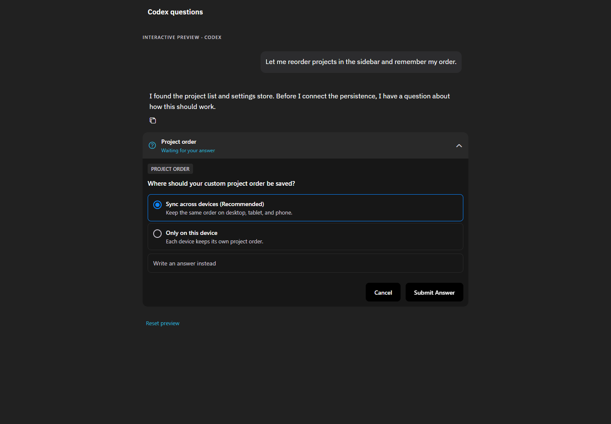
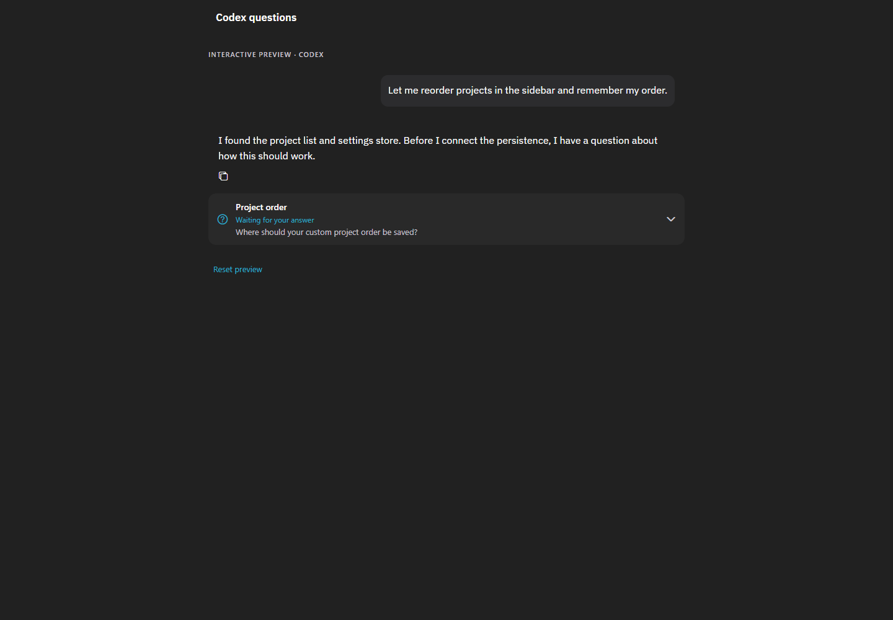
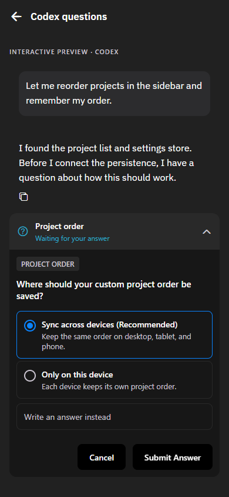
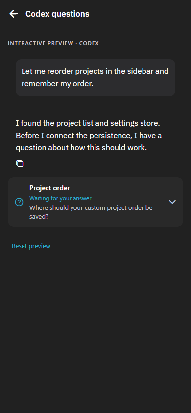
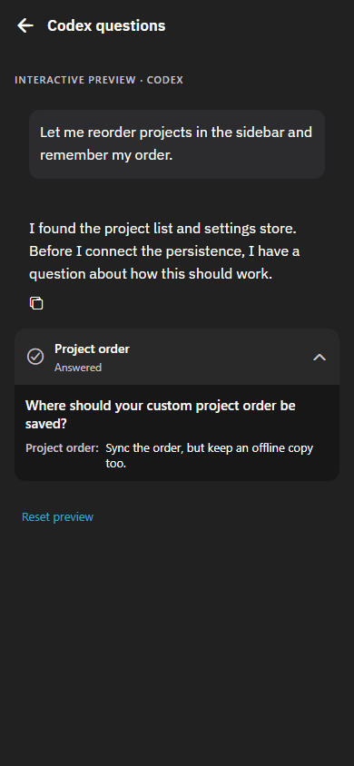

# Collapsible Codex questions

These are browser captures of the production `RequestUserInputCard` inside the interactive preview at `/dev/codex-questions`. The conversation and question are sample data; preview submission and cancellation use local callbacks rather than a live Codex session.

| Surface | Expanded | Collapsed |
| --- | --- | --- |
| Desktop, 1440 × 1000 |  |  |
| Mobile viewport, 390 × 844 |  |  |

After submitting an answer, the card collapses and changes to **Answered**. Reopening it shows the original question and the submitted answer:

## Reproduce

Run `pnpm --filter happy-app web`, then open:

- `/dev/codex-questions` for a choice question with a custom answer.
- `/dev/codex-questions?scenario=text` for a question that only accepts text.
- `/dev/codex-questions?scenario=multiple` for a choice question and a text question in one request.

Choose an option or type an answer, collapse and reopen the card, then submit. **Reset preview** starts a new request. Folding leaves the request pending; **Cancel** resolves it as cancelled.

## Validation

- 123 relevant app tests and 67 existing Codex transport/communication tests passed; app TypeScript checking passed.
- Production JavaScript exports for web, iOS, and Android passed (`expo export --platform all --no-bytecode`).
- Browser checks covered click and Enter toggles, `aria-expanded`/`aria-checked`, hidden form controls, retained selections and written drafts, required answers in mixed forms, successful submission, answer review, and cancellation.
- No horizontal overflow at widths 320, 390, 768, and 1440. The toggle is at least 56 points high; form options and actions are at least 44 points high.

Mobile captures use a browser viewport. Native device interaction and Tauri binaries were not exercised in this Windows environment.
